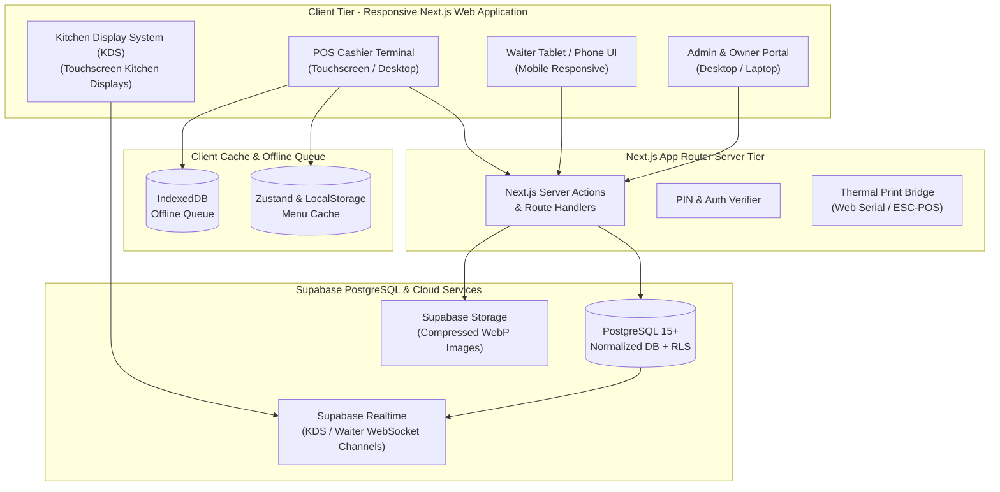
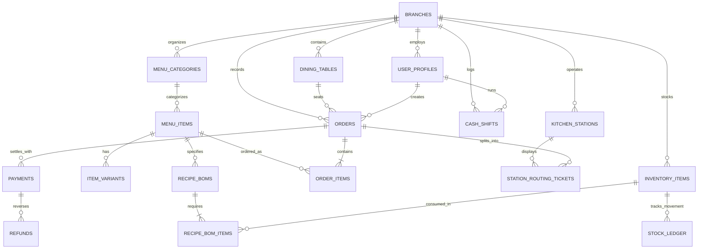

# Technical Architecture & Engineering Plan
## Enterprise Restaurant Management & Point of Sale System

**Document Version:** 1.0.0  
**Target Environment:** Next.js App Router (TypeScript), Supabase (PostgreSQL 15+, Auth, Realtime, Storage), Tailwind CSS, Shadcn UI  
**Default Regional Standard:** Currency: `LKR` (Sri Lankan Rupee, Rs.), Timezone: `Asia/Colombo` (UTC+05:30)  
**Primary Specification Reference:** `restaurant_pos_system_specification.md`

---

## 1. Executive Summary & Architectural Overview

The Restaurant POS and Management System is designed as a mission-critical, high-concurrency web application operating across desktop terminals, touchscreen POS stations, waiter mobile tablets, and kitchen display screens. 

### 1.1 Core Architectural Principles
1. **Multi-Branch Foundation from Day 1:** All operational, transactional, and inventory tables incorporate `branch_id` from inception, allowing a single-branch deployment to scale into a multi-branch franchise model without database migrations or schema redesign.
2. **Strict Financial & Inventory Integrity:**
   - Paid orders are immutable; modifications require authorized void or refund records with user ID, timestamp, and audit trail.
   - Inventory depletions via Recipe Bills of Materials (BOM) are strictly idempotent and executed inside transactional boundaries (`BEGIN ... COMMIT`) referencing unique transaction hashes.
   - Payments are append-only. Corrections are recorded as reciprocal ledger entries.
3. **Decoupled KDS & Payment Lifecycles:** Kitchen preparation status (`submitted` -> `in_preparation` -> `ready` -> `served`) progresses independently from bill settlement status (`unpaid` -> `paid`).
4. **Supabase Free Tier Efficiency:**
   - Static menu metadata (categories, items, variants, modifiers, combos) is cached client-side in Zustand/React Query + `localStorage` and synchronized only on `menu_version` increments, minimizing database egress.
   - All uploaded food imagery is compressed on the client into WebP (< 100 KB) prior to storage.
   - Orders support an offline-ready queue via IndexedDB (`idb`) to guarantee uninterrupted order entry during network hiccups.



---

## 2. Technology Stack & Key Libraries

| Layer | Technology | Version / Tool | Rationale |
|---|---|---|---|
| **Framework** | Next.js (App Router) | v15+ (React 19, TypeScript) | Unified full-stack architecture, high performance Server Components for reports/admin, fast client hydration for POS. |
| **Styling** | Tailwind CSS + Lucide Icons | v3.4+ / v0.4+ | Fast utility styling, responsive breakpoints, high-contrast POS/KDS touch layouts. |
| **Component Library** | Shadcn UI (Radix UI primitives) | Modern headless UI | Accessible, customizable, zero-bloat UI primitives (dialogs, sheets, dropdowns, tables). |
| **Database & Backend** | Supabase (PostgreSQL 15+) | Cloud DB + Edge Functions | Enterprise SQL engine, Row Level Security (RLS), ACID transactions, and JSONB support. |
| **Realtime Engine** | Supabase Realtime | WebSockets | Instant KOT distribution to kitchen stations and waiter ready notifications without polling. |
| **Authentication** | Supabase Auth + Custom PIN Flow | Bcrypt / Argon2 PIN hash | Email/password for Admin/Owner; rapid 4-6 digit PIN entry for Cashiers, Waiters, and Chefs. |
| **Client State & Cache** | Zustand + TanStack Query | v5+ | Ultra-fast local POS cart state, active cash shift state, and cached menu synchronization. |
| **Offline Resilience** | IndexedDB via `idb` | v8+ | Offline order queue, local drafts, and safe synchronization upon network reconnect. |
| **Image Compression** | `browser-image-compression` | Client-side WebP converter | Guarantees <100KB WebP uploads to conserve Supabase Storage and bandwidth. |
| **Printing** | ESC-POS / Web Serial API / Web Print | Custom thermal printer driver | Native 58mm/80mm receipt and KOT thermal printing. |

---

## 3. Database Architecture & Schema Definition

The database is built on PostgreSQL with Row Level Security (RLS) enabled on all tables. 

### 3.1 Schema Overview & Relationship Matrix



---

### 3.2 SQL Schema DDL (Normalized & Production-Ready)

```sql
-- ============================================================================
-- 1. EXTENSIONS & PREREQUISITES
-- ============================================================================
CREATE EXTENSION IF NOT EXISTS "uuid-ossp";
CREATE EXTENSION IF NOT EXISTS "pgcrypto";

-- ============================================================================
-- 2. BRANCHES & SYSTEM CONFIGURATION
-- ============================================================================
CREATE TABLE branches (
    id UUID PRIMARY KEY DEFAULT uuid_generate_v4(),
    code VARCHAR(20) UNIQUE NOT NULL,
    name VARCHAR(100) NOT NULL,
    address TEXT,
    phone VARCHAR(30),
    currency VARCHAR(10) DEFAULT 'LKR' NOT NULL,
    timezone VARCHAR(50) DEFAULT 'Asia/Colombo' NOT NULL,
    tax_rate NUMERIC(5, 2) DEFAULT 0.00,
    service_charge_rate NUMERIC(5, 2) DEFAULT 10.00,
    is_active BOOLEAN DEFAULT TRUE NOT NULL,
    created_at TIMESTAMPTZ DEFAULT TIMEZONE('utc', NOW()) NOT NULL,
    updated_at TIMESTAMPTZ DEFAULT TIMEZONE('utc', NOW()) NOT NULL
);

CREATE TABLE system_settings (
    id UUID PRIMARY KEY DEFAULT uuid_generate_v4(),
    branch_id UUID REFERENCES branches(id) ON DELETE CASCADE NOT NULL,
    key VARCHAR(50) NOT NULL,
    value JSONB NOT NULL,
    updated_at TIMESTAMPTZ DEFAULT TIMEZONE('utc', NOW()) NOT NULL,
    CONSTRAINT uq_branch_setting UNIQUE (branch_id, key)
);

-- Cache invalidation versioning
CREATE TABLE menu_versions (
    branch_id UUID PRIMARY KEY REFERENCES branches(id) ON DELETE CASCADE,
    version_number BIGINT DEFAULT 1 NOT NULL,
    updated_at TIMESTAMPTZ DEFAULT TIMEZONE('utc', NOW()) NOT NULL
);

-- ============================================================================
-- 3. STAFF, ROLES & AUTHENTICATION
-- ============================================================================
CREATE TYPE user_role AS ENUM (
    'super_admin',
    'owner',
    'manager',
    'cashier',
    'waiter',
    'chef',
    'store_keeper'
);

CREATE TABLE user_profiles (
    id UUID PRIMARY KEY REFERENCES auth.users(id) ON DELETE CASCADE,
    branch_id UUID REFERENCES branches(id) ON DELETE RESTRICT NOT NULL,
    role user_role DEFAULT 'cashier' NOT NULL,
    display_name VARCHAR(100) NOT NULL,
    pin_code_hash VARCHAR(255) NOT NULL, -- Bcrypt hash of 4-6 digit fast login PIN
    phone VARCHAR(30),
    is_active BOOLEAN DEFAULT TRUE NOT NULL,
    created_at TIMESTAMPTZ DEFAULT TIMEZONE('utc', NOW()) NOT NULL,
    updated_at TIMESTAMPTZ DEFAULT TIMEZONE('utc', NOW()) NOT NULL
);

CREATE TABLE user_sessions_log (
    id UUID PRIMARY KEY DEFAULT uuid_generate_v4(),
    branch_id UUID REFERENCES branches(id) ON DELETE CASCADE NOT NULL,
    user_id UUID REFERENCES user_profiles(id) ON DELETE CASCADE NOT NULL,
    action VARCHAR(50) NOT NULL, -- login, pin_switch, logout
    device_info TEXT,
    created_at TIMESTAMPTZ DEFAULT TIMEZONE('utc', NOW()) NOT NULL
);

-- ============================================================================
-- 4. CASH SHIFTS & DRAWER RECONCILIATION
-- ============================================================================
CREATE TYPE shift_status AS ENUM ('open', 'closed', 'audited');

CREATE TABLE cash_shifts (
    id UUID PRIMARY KEY DEFAULT uuid_generate_v4(),
    branch_id UUID REFERENCES branches(id) ON DELETE RESTRICT NOT NULL,
    cashier_id UUID REFERENCES user_profiles(id) ON DELETE RESTRICT NOT NULL,
    opened_at TIMESTAMPTZ DEFAULT TIMEZONE('utc', NOW()) NOT NULL,
    closed_at TIMESTAMPTZ,
    opening_float NUMERIC(12, 2) NOT NULL,
    expected_cash NUMERIC(12, 2) DEFAULT 0.00,
    actual_cash NUMERIC(12, 2),
    cash_variance NUMERIC(12, 2),
    total_sales NUMERIC(12, 2) DEFAULT 0.00,
    status shift_status DEFAULT 'open' NOT NULL,
    notes TEXT
);

CREATE TABLE cash_drawer_actions (
    id UUID PRIMARY KEY DEFAULT uuid_generate_v4(),
    shift_id UUID REFERENCES cash_shifts(id) ON DELETE CASCADE NOT NULL,
    branch_id UUID REFERENCES branches(id) ON DELETE RESTRICT NOT NULL,
    user_id UUID REFERENCES user_profiles(id) ON DELETE RESTRICT NOT NULL,
    action_type VARCHAR(20) NOT NULL, -- 'cash_in', 'cash_out', 'drop'
    amount NUMERIC(12, 2) NOT NULL,
    reason TEXT NOT NULL,
    created_at TIMESTAMPTZ DEFAULT TIMEZONE('utc', NOW()) NOT NULL
);

-- ============================================================================
-- 5. DINING FLOORS & TABLES
-- ============================================================================
CREATE TABLE restaurant_floors (
    id UUID PRIMARY KEY DEFAULT uuid_generate_v4(),
    branch_id UUID REFERENCES branches(id) ON DELETE CASCADE NOT NULL,
    name VARCHAR(50) NOT NULL, -- e.g. "Main Dining Area", "Rooftop Terrace"
    display_order INT DEFAULT 1 NOT NULL
);

CREATE TYPE table_status AS ENUM ('available', 'occupied', 'reserved', 'cleaning');

CREATE TABLE dining_tables (
    id UUID PRIMARY KEY DEFAULT uuid_generate_v4(),
    branch_id UUID REFERENCES branches(id) ON DELETE CASCADE NOT NULL,
    floor_id UUID REFERENCES restaurant_floors(id) ON DELETE CASCADE NOT NULL,
    table_number VARCHAR(20) NOT NULL,
    seating_capacity INT DEFAULT 4 NOT NULL,
    status table_status DEFAULT 'available' NOT NULL,
    current_order_id UUID, -- Foreign key linked to orders(id)
    pos_x INT DEFAULT 0,
    pos_y INT DEFAULT 0,
    is_active BOOLEAN DEFAULT TRUE NOT NULL,
    CONSTRAINT uq_branch_table_num UNIQUE (branch_id, table_number)
);

-- ============================================================================
-- 6. KITCHEN STATIONS
-- ============================================================================
CREATE TABLE kitchen_stations (
    id UUID PRIMARY KEY DEFAULT uuid_generate_v4(),
    branch_id UUID REFERENCES branches(id) ON DELETE CASCADE NOT NULL,
    code VARCHAR(20) NOT NULL, -- 'HOT', 'GRILL', 'BEV', 'DESSERT'
    name VARCHAR(100) NOT NULL,
    printer_ip VARCHAR(50),
    is_active BOOLEAN DEFAULT TRUE NOT NULL,
    CONSTRAINT uq_branch_station_code UNIQUE (branch_id, code)
);

-- ============================================================================
-- 7. MENU, VARIANTS, MODIFIERS & COMBOS
-- ============================================================================
CREATE TABLE menu_categories (
    id UUID PRIMARY KEY DEFAULT uuid_generate_v4(),
    branch_id UUID REFERENCES branches(id) ON DELETE CASCADE NOT NULL,
    name VARCHAR(100) NOT NULL,
    icon_name VARCHAR(50),
    display_order INT DEFAULT 1 NOT NULL,
    is_active BOOLEAN DEFAULT TRUE NOT NULL
);

CREATE TABLE menu_items (
    id UUID PRIMARY KEY DEFAULT uuid_generate_v4(),
    branch_id UUID REFERENCES branches(id) ON DELETE CASCADE NOT NULL,
    category_id UUID REFERENCES menu_categories(id) ON DELETE RESTRICT NOT NULL,
    default_station_id UUID REFERENCES kitchen_stations(id) ON DELETE SET NULL,
    name VARCHAR(150) NOT NULL,
    sku VARCHAR(50),
    description TEXT,
    base_price NUMERIC(10, 2) NOT NULL,
    image_url TEXT, -- Client compressed WebP < 100KB
    is_available BOOLEAN DEFAULT TRUE NOT NULL,
    tax_exempt BOOLEAN DEFAULT FALSE NOT NULL,
    display_order INT DEFAULT 1 NOT NULL,
    created_at TIMESTAMPTZ DEFAULT TIMEZONE('utc', NOW()) NOT NULL,
    updated_at TIMESTAMPTZ DEFAULT TIMEZONE('utc', NOW()) NOT NULL
);

CREATE TABLE item_variants (
    id UUID PRIMARY KEY DEFAULT uuid_generate_v4(),
    menu_item_id UUID REFERENCES menu_items(id) ON DELETE CASCADE NOT NULL,
    variant_name VARCHAR(50) NOT NULL, -- 'Small', 'Medium', 'Large', 'Full'
    price_override NUMERIC(10, 2) NOT NULL,
    is_default BOOLEAN DEFAULT FALSE NOT NULL
);

CREATE TABLE modifier_groups (
    id UUID PRIMARY KEY DEFAULT uuid_generate_v4(),
    branch_id UUID REFERENCES branches(id) ON DELETE CASCADE NOT NULL,
    title VARCHAR(100) NOT NULL, -- 'Spice Level', 'Add Extra Protein'
    min_selection INT DEFAULT 0 NOT NULL,
    max_selection INT DEFAULT 1 NOT NULL
);

CREATE TABLE modifiers (
    id UUID PRIMARY KEY DEFAULT uuid_generate_v4(),
    group_id UUID REFERENCES modifier_groups(id) ON DELETE CASCADE NOT NULL,
    name VARCHAR(100) NOT NULL,
    price_addition NUMERIC(10, 2) DEFAULT 0.00 NOT NULL
);

CREATE TABLE menu_item_modifier_groups (
    menu_item_id UUID REFERENCES menu_items(id) ON DELETE CASCADE NOT NULL,
    modifier_group_id UUID REFERENCES modifier_groups(id) ON DELETE CASCADE NOT NULL,
    PRIMARY KEY (menu_item_id, modifier_group_id)
);

CREATE TABLE combo_meals (
    id UUID PRIMARY KEY DEFAULT uuid_generate_v4(),
    branch_id UUID REFERENCES branches(id) ON DELETE CASCADE NOT NULL,
    name VARCHAR(150) NOT NULL,
    combo_price NUMERIC(10, 2) NOT NULL,
    is_available BOOLEAN DEFAULT TRUE NOT NULL
);

CREATE TABLE combo_meal_items (
    id UUID PRIMARY KEY DEFAULT uuid_generate_v4(),
    combo_id UUID REFERENCES combo_meals(id) ON DELETE CASCADE NOT NULL,
    menu_item_id UUID REFERENCES menu_items(id) ON DELETE CASCADE NOT NULL,
    quantity INT DEFAULT 1 NOT NULL
);

-- ============================================================================
-- 8. CUSTOMERS & LOYALTY
-- ============================================================================
CREATE TABLE customers (
    id UUID PRIMARY KEY DEFAULT uuid_generate_v4(),
    branch_id UUID REFERENCES branches(id) ON DELETE RESTRICT NOT NULL,
    name VARCHAR(100) NOT NULL,
    phone VARCHAR(30) UNIQUE NOT NULL,
    email VARCHAR(100),
    delivery_address TEXT,
    loyalty_points INT DEFAULT 0 NOT NULL,
    notes TEXT,
    created_at TIMESTAMPTZ DEFAULT TIMEZONE('utc', NOW()) NOT NULL
);

-- ============================================================================
-- 9. ORDERS & ORDER ITEMS
-- ============================================================================
CREATE TYPE order_type AS ENUM ('dine_in', 'takeaway', 'delivery');
CREATE TYPE kds_status AS ENUM (
    'draft',
    'submitted',
    'in_preparation',
    'partially_ready',
    'ready',
    'served',
    'completed',
    'cancelled'
);
CREATE TYPE payment_status AS ENUM (
    'unpaid',
    'partially_paid',
    'paid',
    'refunded',
    'voided'
);

CREATE TABLE orders (
    id UUID PRIMARY KEY DEFAULT uuid_generate_v4(),
    branch_id UUID REFERENCES branches(id) ON DELETE RESTRICT NOT NULL,
    order_number VARCHAR(50) NOT NULL, -- Human-readable: ORD-YYYYMMDD-XXXX
    order_type order_type DEFAULT 'dine_in' NOT NULL,
    table_id UUID REFERENCES dining_tables(id) ON DELETE SET NULL,
    customer_id UUID REFERENCES customers(id) ON DELETE SET NULL,
    cashier_id UUID REFERENCES user_profiles(id) ON DELETE RESTRICT NOT NULL,
    waiter_id UUID REFERENCES user_profiles(id) ON DELETE SET NULL,
    shift_id UUID REFERENCES cash_shifts(id) ON DELETE RESTRICT,
    kds_status kds_status DEFAULT 'submitted' NOT NULL,
    payment_status payment_status DEFAULT 'unpaid' NOT NULL,
    subtotal NUMERIC(12, 2) DEFAULT 0.00 NOT NULL,
    discount_amount NUMERIC(12, 2) DEFAULT 0.00 NOT NULL,
    tax_amount NUMERIC(12, 2) DEFAULT 0.00 NOT NULL,
    service_charge_amount NUMERIC(12, 2) DEFAULT 0.00 NOT NULL,
    delivery_fee NUMERIC(12, 2) DEFAULT 0.00 NOT NULL,
    total_amount NUMERIC(12, 2) DEFAULT 0.00 NOT NULL,
    paid_amount NUMERIC(12, 2) DEFAULT 0.00 NOT NULL,
    notes TEXT,
    offline_temp_id VARCHAR(100), -- Local IndexedDB reference for sync
    created_at TIMESTAMPTZ DEFAULT TIMEZONE('utc', NOW()) NOT NULL,
    updated_at TIMESTAMPTZ DEFAULT TIMEZONE('utc', NOW()) NOT NULL,
    CONSTRAINT uq_branch_order_number UNIQUE (branch_id, order_number)
);

CREATE TABLE order_items (
    id UUID PRIMARY KEY DEFAULT uuid_generate_v4(),
    order_id UUID REFERENCES orders(id) ON DELETE CASCADE NOT NULL,
    branch_id UUID REFERENCES branches(id) ON DELETE RESTRICT NOT NULL,
    menu_item_id UUID REFERENCES menu_items(id) ON DELETE RESTRICT NOT NULL,
    variant_id UUID REFERENCES item_variants(id) ON DELETE SET NULL,
    item_name VARCHAR(150) NOT NULL,
    unit_price NUMERIC(10, 2) NOT NULL,
    quantity INT NOT NULL CHECK (quantity > 0),
    subtotal NUMERIC(10, 2) NOT NULL,
    station_id UUID REFERENCES kitchen_stations(id) ON DELETE RESTRICT NOT NULL,
    kds_status kds_status DEFAULT 'submitted' NOT NULL,
    notes TEXT,
    created_at TIMESTAMPTZ DEFAULT TIMEZONE('utc', NOW()) NOT NULL
);

CREATE TABLE order_item_modifiers (
    id UUID PRIMARY KEY DEFAULT uuid_generate_v4(),
    order_item_id UUID REFERENCES order_items(id) ON DELETE CASCADE NOT NULL,
    modifier_id UUID REFERENCES modifiers(id) ON DELETE RESTRICT NOT NULL,
    modifier_name VARCHAR(100) NOT NULL,
    unit_price NUMERIC(10, 2) NOT NULL
);

-- ============================================================================
-- 10. STATION ROUTING TICKETS (KOT & KDS REALTIME)
-- ============================================================================
CREATE TABLE station_routing_tickets (
    id UUID PRIMARY KEY DEFAULT uuid_generate_v4(),
    ticket_number VARCHAR(50) NOT NULL, -- e.g. TKT-HOT-0012
    order_id UUID REFERENCES orders(id) ON DELETE CASCADE NOT NULL,
    branch_id UUID REFERENCES branches(id) ON DELETE RESTRICT NOT NULL,
    station_id UUID REFERENCES kitchen_stations(id) ON DELETE RESTRICT NOT NULL,
    status kds_status DEFAULT 'submitted' NOT NULL,
    started_at TIMESTAMPTZ,
    ready_at TIMESTAMPTZ,
    completed_at TIMESTAMPTZ,
    prepared_by_user_id UUID REFERENCES user_profiles(id) ON DELETE SET NULL,
    created_at TIMESTAMPTZ DEFAULT TIMEZONE('utc', NOW()) NOT NULL
);

CREATE TABLE station_ticket_items (
    ticket_id UUID REFERENCES station_routing_tickets(id) ON DELETE CASCADE NOT NULL,
    order_item_id UUID REFERENCES order_items(id) ON DELETE CASCADE NOT NULL,
    PRIMARY KEY (ticket_id, order_item_id)
);

-- ============================================================================
-- 11. RECIPES (BOM) & INVENTORY MANAGEMENT
-- ============================================================================
CREATE TABLE inventory_units (
    id UUID PRIMARY KEY DEFAULT uuid_generate_v4(),
    unit_name VARCHAR(50) NOT NULL, -- 'Kilogram', 'Gram', 'Liter', 'Milliliter', 'Piece'
    symbol VARCHAR(10) NOT NULL UNIQUE
);

CREATE TABLE inventory_items (
    id UUID PRIMARY KEY DEFAULT uuid_generate_v4(),
    branch_id UUID REFERENCES branches(id) ON DELETE CASCADE NOT NULL,
    name VARCHAR(150) NOT NULL,
    sku VARCHAR(50),
    unit_id UUID REFERENCES inventory_units(id) ON DELETE RESTRICT NOT NULL,
    cost_price NUMERIC(10, 2) DEFAULT 0.00 NOT NULL,
    current_stock NUMERIC(12, 3) DEFAULT 0.000 NOT NULL,
    min_stock_alert NUMERIC(12, 3) DEFAULT 5.000 NOT NULL,
    created_at TIMESTAMPTZ DEFAULT TIMEZONE('utc', NOW()) NOT NULL,
    updated_at TIMESTAMPTZ DEFAULT TIMEZONE('utc', NOW()) NOT NULL
);

CREATE TABLE recipe_boms (
    id UUID PRIMARY KEY DEFAULT uuid_generate_v4(),
    menu_item_id UUID REFERENCES menu_items(id) ON DELETE CASCADE NOT NULL,
    variant_id UUID REFERENCES item_variants(id) ON DELETE CASCADE,
    yield_quantity NUMERIC(8, 2) DEFAULT 1.00 NOT NULL,
    created_at TIMESTAMPTZ DEFAULT TIMEZONE('utc', NOW()) NOT NULL,
    CONSTRAINT uq_item_variant_bom UNIQUE (menu_item_id, variant_id)
);

CREATE TABLE recipe_bom_items (
    id UUID PRIMARY KEY DEFAULT uuid_generate_v4(),
    bom_id UUID REFERENCES recipe_boms(id) ON DELETE CASCADE NOT NULL,
    ingredient_id UUID REFERENCES inventory_items(id) ON DELETE RESTRICT NOT NULL,
    quantity NUMERIC(10, 4) NOT NULL, -- e.g. 0.250 for 250g
    unit_id UUID REFERENCES inventory_units(id) ON DELETE RESTRICT NOT NULL
);

-- Immutable Stock Movements with Idempotency Protection
CREATE TYPE stock_movement_type AS ENUM (
    'sale_deduction',
    'sale_reversal',
    'purchase_grn',
    'wastage_spoilage',
    'manual_adjustment',
    'branch_transfer'
);

CREATE TABLE stock_ledger (
    id UUID PRIMARY KEY DEFAULT uuid_generate_v4(),
    branch_id UUID REFERENCES branches(id) ON DELETE RESTRICT NOT NULL,
    ingredient_id UUID REFERENCES inventory_items(id) ON DELETE RESTRICT NOT NULL,
    movement_type stock_movement_type NOT NULL,
    quantity NUMERIC(12, 3) NOT NULL, -- Negative for depletions, positive for additions
    unit_cost NUMERIC(10, 2) NOT NULL,
    reference_order_id UUID REFERENCES orders(id) ON DELETE SET NULL,
    reference_order_item_id UUID REFERENCES order_items(id) ON DELETE SET NULL,
    idempotent_key VARCHAR(100) UNIQUE NOT NULL, -- Prevents duplicate stock deductions
    notes TEXT,
    created_by UUID REFERENCES user_profiles(id) ON DELETE RESTRICT NOT NULL,
    created_at TIMESTAMPTZ DEFAULT TIMEZONE('utc', NOW()) NOT NULL
);

-- ============================================================================
-- 12. SUPPLIERS, PURCHASE ORDERS & GOODS RECEIVED NOTES (GRN)
-- ============================================================================
CREATE TABLE suppliers (
    id UUID PRIMARY KEY DEFAULT uuid_generate_v4(),
    branch_id UUID REFERENCES branches(id) ON DELETE CASCADE NOT NULL,
    name VARCHAR(150) NOT NULL,
    contact_person VARCHAR(100),
    phone VARCHAR(30) NOT NULL,
    email VARCHAR(100),
    address TEXT,
    is_active BOOLEAN DEFAULT TRUE NOT NULL
);

CREATE TYPE po_status AS ENUM ('draft', 'ordered', 'partially_received', 'completed', 'cancelled');

CREATE TABLE purchase_orders (
    id UUID PRIMARY KEY DEFAULT uuid_generate_v4(),
    branch_id UUID REFERENCES branches(id) ON DELETE RESTRICT NOT NULL,
    supplier_id UUID REFERENCES suppliers(id) ON DELETE RESTRICT NOT NULL,
    po_number VARCHAR(50) NOT NULL,
    status po_status DEFAULT 'draft' NOT NULL,
    total_cost NUMERIC(12, 2) DEFAULT 0.00 NOT NULL,
    created_by UUID REFERENCES user_profiles(id) ON DELETE RESTRICT NOT NULL,
    created_at TIMESTAMPTZ DEFAULT TIMEZONE('utc', NOW()) NOT NULL,
    CONSTRAINT uq_branch_po_number UNIQUE (branch_id, po_number)
);

CREATE TABLE goods_received_notes (
    id UUID PRIMARY KEY DEFAULT uuid_generate_v4(),
    po_id UUID REFERENCES purchase_orders(id) ON DELETE RESTRICT NOT NULL,
    branch_id UUID REFERENCES branches(id) ON DELETE RESTRICT NOT NULL,
    supplier_id UUID REFERENCES suppliers(id) ON DELETE RESTRICT NOT NULL,
    grn_number VARCHAR(50) NOT NULL,
    invoice_number VARCHAR(50),
    total_received_amount NUMERIC(12, 2) NOT NULL,
    received_by UUID REFERENCES user_profiles(id) ON DELETE RESTRICT NOT NULL,
    received_at TIMESTAMPTZ DEFAULT TIMEZONE('utc', NOW()) NOT NULL
);

CREATE TABLE grn_items (
    id UUID PRIMARY KEY DEFAULT uuid_generate_v4(),
    grn_id UUID REFERENCES goods_received_notes(id) ON DELETE CASCADE NOT NULL,
    ingredient_id UUID REFERENCES inventory_items(id) ON DELETE RESTRICT NOT NULL,
    quantity_received NUMERIC(12, 3) NOT NULL,
    unit_cost NUMERIC(10, 2) NOT NULL,
    subtotal NUMERIC(12, 2) NOT NULL
);

-- ============================================================================
-- 13. PAYMENTS & REFUNDS (IMMUTABLE FINANCIAL LEDGER)
-- ============================================================================
CREATE TYPE payment_method AS ENUM (
    'cash',
    'credit_card',
    'debit_card',
    'bank_transfer',
    'qr_payment',
    'customer_credit'
);

CREATE TABLE payments (
    id UUID PRIMARY KEY DEFAULT uuid_generate_v4(),
    order_id UUID REFERENCES orders(id) ON DELETE RESTRICT NOT NULL,
    branch_id UUID REFERENCES branches(id) ON DELETE RESTRICT NOT NULL,
    shift_id UUID REFERENCES cash_shifts(id) ON DELETE RESTRICT NOT NULL,
    method payment_method NOT NULL,
    amount NUMERIC(12, 2) NOT NULL CHECK (amount > 0),
    currency VARCHAR(10) DEFAULT 'LKR' NOT NULL,
    transaction_ref VARCHAR(100), -- Card auth code, bank transfer reference, etc.
    created_by UUID REFERENCES user_profiles(id) ON DELETE RESTRICT NOT NULL,
    created_at TIMESTAMPTZ DEFAULT TIMEZONE('utc', NOW()) NOT NULL
);

CREATE TABLE refunds (
    id UUID PRIMARY KEY DEFAULT uuid_generate_v4(),
    payment_id UUID REFERENCES payments(id) ON DELETE RESTRICT NOT NULL,
    order_id UUID REFERENCES orders(id) ON DELETE RESTRICT NOT NULL,
    branch_id UUID REFERENCES branches(id) ON DELETE RESTRICT NOT NULL,
    shift_id UUID REFERENCES cash_shifts(id) ON DELETE RESTRICT NOT NULL,
    amount NUMERIC(12, 2) NOT NULL CHECK (amount > 0),
    reason TEXT NOT NULL,
    authorized_by UUID REFERENCES user_profiles(id) ON DELETE RESTRICT NOT NULL,
    created_by UUID REFERENCES user_profiles(id) ON DELETE RESTRICT NOT NULL,
    created_at TIMESTAMPTZ DEFAULT TIMEZONE('utc', NOW()) NOT NULL
);

-- ============================================================================
-- 14. AUDIT LOGS (SYSTEM INTEGRITY & SENSITIVE ACTIONS)
-- ============================================================================
CREATE TABLE audit_logs (
    id UUID PRIMARY KEY DEFAULT uuid_generate_v4(),
    branch_id UUID REFERENCES branches(id) ON DELETE CASCADE NOT NULL,
    user_id UUID REFERENCES user_profiles(id) ON DELETE RESTRICT NOT NULL,
    action_type VARCHAR(50) NOT NULL, -- 'order_void', 'item_cancel', 'refund', 'price_change', 'stock_adjustment'
    entity_name VARCHAR(50) NOT NULL,
    entity_id UUID NOT NULL,
    old_data JSONB,
    new_data JSONB,
    reason TEXT NOT NULL,
    ip_address VARCHAR(45),
    created_at TIMESTAMPTZ DEFAULT TIMEZONE('utc', NOW()) NOT NULL
);

-- ============================================================================
-- 15. PERFORMANCE INDEXES
-- ============================================================================
CREATE INDEX idx_orders_branch_kds ON orders(branch_id, kds_status);
CREATE INDEX idx_orders_branch_payment ON orders(branch_id, payment_status);
CREATE INDEX idx_orders_created_at ON orders(created_at DESC);
CREATE INDEX idx_orders_table_id ON orders(table_id) WHERE table_id IS NOT NULL;
CREATE INDEX idx_order_items_order_id ON order_items(order_id);
CREATE INDEX idx_station_tickets_status ON station_routing_tickets(branch_id, station_id, status);
CREATE INDEX idx_stock_ledger_idempotent ON stock_ledger(idempotent_key);
CREATE INDEX idx_stock_ledger_ingredient ON stock_ledger(ingredient_id, created_at DESC);
CREATE INDEX idx_payments_order_id ON payments(order_id);
CREATE INDEX idx_payments_shift_id ON payments(shift_id);
CREATE INDEX idx_audit_logs_entity ON audit_logs(entity_name, entity_id);
```

---

### 3.3 Row Level Security (RLS) Strategy & Stored Procedures

All tables enable RLS (`ALTER TABLE <table> ENABLE ROW LEVEL SECURITY;`).

#### Tenant / Branch Isolation Policy:
Every authenticated user session resolves their `branch_id` from `user_profiles`. Queries are automatically scoped to the staff member's branch:
```sql
-- Pattern for tenant isolation
CREATE POLICY branch_isolation_policy ON orders
    FOR ALL
    USING (
        branch_id = (SELECT branch_id FROM user_profiles WHERE id = auth.uid())
        OR (SELECT role FROM user_profiles WHERE id = auth.uid()) = 'super_admin'
    );
```

#### Idempotent Stock Deduction Procedure:
```sql
CREATE OR REPLACE FUNCTION deduct_order_bom_stock(
    p_order_id UUID,
    p_user_id UUID,
    p_trigger_type VARCHAR(50)
)
RETURNS VOID
LANGUAGE plpgsql
SECURITY DEFINER
AS $$
DECLARE
    r_item RECORD;
    r_bom RECORD;
    v_branch_id UUID;
    v_idempotent_key VARCHAR(100);
BEGIN
    SELECT branch_id INTO v_branch_id FROM orders WHERE id = p_order_id;
    
    FOR r_item IN 
        SELECT id, menu_item_id, variant_id, quantity 
        FROM order_items 
        WHERE order_id = p_order_id
    LOOP
        -- Find BOM ingredients
        FOR r_bom IN 
            SELECT rbi.ingredient_id, rbi.quantity AS qty_per_dish, ii.cost_price
            FROM recipe_boms rb
            JOIN recipe_bom_items rbi ON rb.id = rbi.bom_id
            JOIN inventory_items ii ON rbi.ingredient_id = ii.id
            WHERE rb.menu_item_id = r_item.menu_item_id 
              AND (rb.variant_id = r_item.variant_id OR rb.variant_id IS NULL)
        LOOP
            v_idempotent_key := 'DEDUCT_' || p_order_id || '_' || r_item.id || '_' || r_bom.ingredient_id;
            
            -- Insert ledger record only if not already deducted
            INSERT INTO stock_ledger (
                branch_id, ingredient_id, movement_type, quantity,
                unit_cost, reference_order_id, reference_order_item_id,
                idempotent_key, notes, created_by
            )
            VALUES (
                v_branch_id, r_bom.ingredient_id, 'sale_deduction',
                -(r_bom.qty_per_dish * r_item.quantity),
                r_bom.cost_price, p_order_id, r_item.id,
                v_idempotent_key, 'Automatic BOM deduction: ' || p_trigger_type, p_user_id
            )
            ON CONFLICT (idempotent_key) DO NOTHING;

            -- Update current stock counter
            UPDATE inventory_items
            SET current_stock = current_stock - (r_bom.qty_per_dish * r_item.quantity),
                updated_at = TIMEZONE('utc', NOW())
            WHERE id = r_bom.ingredient_id;
        END LOOP;
    END LOOP;
END;
$$;
```

---

## 4. Next.js App Router Folder & Module Structure

The project is structured strictly using Next.js App Router Route Groups to achieve physical separation between cashier POS, kitchen display, waiter tablet, and back-office management.

```
restaurant-pos/
├── .agent/
│   └── rules/
│       └── project-rules.md               # Core constraints & Supabase optimization rules
├── docs/
│   └── ARCHITECTURE_PLAN.md               # Technical architecture & schema plan
├── public/
│   ├── sounds/                            # KDS new order bell & alert audio files
│   └── icons/                             # SVG icons for categories, stations, tables
├── src/
│   ├── app/
│   │   ├── (auth)/                        # Authentication & Fast User Switching
│   │   │   ├── login/
│   │   │   │   └── page.tsx               # Manager / Super Admin password login
│   │   │   ├── pin-entry/
│   │   │   │   └── page.tsx               # Touchscreen PIN pad for quick staff sign-in
│   │   │   └── layout.tsx
│   │   │
│   │   ├── (pos)/                         # Cashier Counter POS
│   │   │   ├── pos/
│   │   │   │   ├── page.tsx               # Main order-taking screen (Grid + Cart)
│   │   │   │   ├── [orderId]/
│   │   │   │   │   └── page.tsx           # Order detail & bill settlement screen
│   │   │   ├── shifts/
│   │   │   │   └── page.tsx               # Cash drawer open/close & reconciliation
│   │   │   ├── orders/
│   │   │   │   └── page.tsx               # Order history & receipt reprinting
│   │   │   └── layout.tsx                 # POS-specific header (shift status, quick PIN switch)
│   │   │
│   │   ├── (kds)/                         # Kitchen Display System
│   │   │   ├── kds/
│   │   │   │   ├── page.tsx               # Multi-station or all-station kitchen monitor
│   │   │   │   └── [stationCode]/
│   │   │   │       └── page.tsx           # Station-specific view (e.g. /kds/HOT, /kds/GRILL)
│   │   │   └── layout.tsx                 # Fullscreen high-contrast dark layout + WebAudio alerts
│   │   │
│   │   ├── (waiter)/                      # Waiter Mobile & Tablet Interface
│   │   │   ├── waiter/
│   │   │   │   ├── tables/
│   │   │   │   │   └── page.tsx           # Interactive floor plan & table assignment
│   │   │   │   ├── order/
│   │   │   │   │   └── [tableId]/
│   │   │   │   │       └── page.tsx       # Touch-friendly menu selection & send-to-kitchen
│   │   │   │   └── ready/
│   │   │   │       └── page.tsx           # Ready items notification queue for serving
│   │   │   └── layout.tsx                 # Mobile-first navigation bar
│   │   │
│   │   ├── (admin)/                       # Back-Office & Business Operations
│   │   │   ├── admin/
│   │   │   │   ├── dashboard/
│   │   │   │   │   └── page.tsx           # Owner sales metrics, peak hours, gross profits
│   │   │   │   ├── menu/
│   │   │   │   │   ├── categories/page.tsx
│   │   │   │   │   ├── items/page.tsx     # Menu item creator with client WebP compression
│   │   │   │   │   ├── modifiers/page.tsx
│   │   │   │   │   └── combos/page.tsx
│   │   │   │   ├── inventory/
│   │   │   │   │   ├── stock/page.tsx     # Current stock, low stock warnings
│   │   │   │   │   ├── recipes/page.tsx   # BOM recipe linking & food costing
│   │   │   │   │   └── wastage/page.tsx   # Spoilage & adjustment logs
│   │   │   │   ├── purchasing/
│   │   │   │   │   ├── suppliers/page.tsx
│   │   │   │   │   ├── po/page.tsx        # Purchase orders
│   │   │   │   │   └── grn/page.tsx       # Goods received note & auto-stock replenishment
│   │   │   │   ├── staff/
│   │   │   │   │   ├── users/page.tsx     # Staff register & PIN assignment
│   │   │   │   │   └── roles/page.tsx     # Permissions matrix
│   │   │   │   ├── tables/
│   │   │   │   │   └── page.tsx           # Floor plan editor (drag-and-drop table positions)
│   │   │   │   ├── reports/
│   │   │   │   │   ├── sales/page.tsx     # Category, item, staff sales breakdowns
│   │   │   │   │   ├── shifts/page.tsx    # Cash shift overage/shortage audits
│   │   │   │   │   └── financial/page.tsx # Revenue, taxes, service charges, profit margins
│   │   │   │   ├── audit-logs/
│   │   │   │   │   └── page.tsx           # Immutable log of voids, cancellations & refunds
│   │   │   │   └── settings/
│   │   │   │       └── page.tsx           # Branch config, tax rates, printer IP setup
│   │   │   └── layout.tsx                 # Standard admin sidebar layout
│   │   │
│   │   ├── api/                           # Route Handlers
│   │   │   ├── auth/pin-verify/route.ts
│   │   │   ├── orders/offline-sync/route.ts
│   │   │   └── print/raw-escpos/route.ts
│   │   ├── layout.tsx                     # Root layout with React Query provider & ThemeProvider
│   │   └── page.tsx                       # Root landing / redirector based on user role
│   │
│   ├── components/
│   │   ├── ui/                            # Shadcn UI primitives (Button, Dialog, Card, etc.)
│   │   ├── pos/                           # POS Cart, ModifierModal, SplitBillDialog, TenderModal
│   │   ├── kds/                           # TicketCard, PreparationTimer, StationFilter
│   │   ├── waiter/                        # FloorMap, TableCard, ServingAlertBadge
│   │   ├── admin/                         # MetricCard, RecipeBOMTable, StockVarianceWidget
│   │   └── shared/                        # PriceDisplay (LKR), TimeDisplay (Colombo), PINPad
│   │
│   ├── hooks/
│   │   ├── use-menu-cache.ts              # LocalStorage + React Query cached menu
│   │   ├── use-kds-realtime.ts            # Supabase Realtime station ticket subscriber
│   │   ├── use-offline-queue.ts           # IndexedDB draft order buffer & syncer
│   │   ├── use-thermal-printer.ts         # ESC-POS / Web Serial receipt generator
│   │   └── use-active-shift.ts            # Cashier drawer session validator
│   │
│   ├── lib/
│   │   ├── supabase/
│   │   │   ├── client.ts                  # Browser Supabase client (Anon key)
│   │   │   ├── server.ts                  # Server Action Supabase client (Cookies / Auth)
│   │   │   └── admin.ts                   # Service Role client (isolated to Server Actions)
│   │   ├── utils/
│   │   │   ├── currency.ts                # LKR formatter (e.g. "Rs. 1,450.00")
│   │   │   ├── datetime.ts                # UTC to 'Asia/Colombo' converter
│   │   │   ├── image-compression.ts       # WebP client-side compressor (<100KB)
│   │   │   └── id-generator.ts            # ORD-YYYYMMDD-XXXX generator
│   │   └── printer/
│   │       ├── escpos-builder.ts          # Thermal receipt & KOT layout builder
│   │       └── ticket-templates.ts
│   │
│   ├── stores/
│   │   ├── cart-store.ts                  # Zustand active POS cart state
│   │   ├── shift-store.ts                 # Current active cash shift state
│   │   └── user-session-store.ts          # Active staff PIN session
│   │
│   └── types/
│       ├── database.types.ts              # Auto-generated Supabase TypeScript schema
│       └── pos.types.ts                   # CartItem, OrderDraft, TicketPayload
├── .gitignore
├── package.json
├── tailwind.config.ts
└── tsconfig.json
```

---

## 5. Phased Implementation Roadmap & Verification Milestones

The roadmap decomposes the 4 phases from Section 10 of the SRS into small, testable milestones. Each milestone defines the exact deliverables, database migrations, UI components, verification criteria, and the corresponding Git commit checkpoint.

---

### Phase 1: Core Restaurant Operations (Order-to-Kitchen-to-Payment Lifecycle)

#### Milestone 1.1: Project Skeleton, Security & Supabase Foundation
- **Scope:** Initialize Next.js 15 (TypeScript, Tailwind, Shadcn UI), Supabase client configurations (`client.ts`, `server.ts`, `admin.ts`), environment variables schema (`.env.example`), and baseline styling.
- **Database:** Baseline schema migration: `branches`, `system_settings`, `user_profiles`, `user_sessions_log`.
- **Verification:** `npm run build` succeeds, Supabase connection verified via health check script.
- **Git Commit:** `feat: initialize Next.js app router skeleton with Supabase auth foundation`

#### Milestone 1.2: Staff PIN Authentication & Shift Management
- **Scope:** Touchscreen PIN pad modal, 4-6 digit fast PIN verification via bcrypt hash RPC, Cashier shift open/close modal with opening float and cash drawer count.
- **Database:** `cash_shifts`, `cash_drawer_actions`, RLS policies for cashier shift access.
- **UI:** `/pin-entry` screen, `ShiftOpenDialog`, `ShiftCloseSummaryModal`.
- **Verification:** Cashier logs in with 4-digit PIN, opens shift with float Rs. 5,000, drawer record persists in Supabase.
- **Git Commit:** `feat: add quick PIN authentication and cashier shift management`

#### Milestone 1.3: Menu Architecture & Client-Side Caching Engine
- **Scope:** Categories, items, variants, modifier groups, and combo meals. Client-side caching engine in Zustand + `localStorage` with version check against `menu_versions`.
- **Database:** `menu_categories`, `menu_items`, `item_variants`, `modifier_groups`, `modifiers`, `menu_versions`.
- **UI:** Admin menu management screens (`/admin/menu/items`, `/admin/menu/categories`), WebP image client compressor (<100KB).
- **Verification:** Menu items render instantly on POS screen from cache; updates in admin increment version and re-hydrate cache.
- **Git Commit:** `feat: implement menu management with client-side WebP compression and cache engine`

#### Milestone 1.4: Dining Floor Plan & Table Management
- **Scope:** Floor plan visual layout, sections, tables with status indicators (`available`, `occupied`, `reserved`, `cleaning`).
- **Database:** `restaurant_floors`, `dining_tables`.
- **UI:** Interactive floor grid (`/waiter/tables`, `/pos`), table selection and status toggle.
- **Verification:** Changing table status or assigning an order updates table state in real-time.
- **Git Commit:** `feat: build interactive table management and floor layout`

#### Milestone 1.5: POS Counter Billing Screen & Cart Engine
- **Scope:** Fast touchscreen counter POS. Category tab switching, search filter, item options/modifiers modal, cart item quantity adjustments, item notes, dine-in/takeaway/delivery mode toggles.
- **Database:** None (Zustand client store + IndexedDB draft order buffer).
- **UI:** `/pos` order-taking interface with category sidebar, product grid, cart panel, customer quick-selector.
- **Verification:** Cashier selects 3 items with modifiers; cart computes subtotal, taxes, service charges in LKR correctly.
- **Git Commit:** `feat: implement high-speed POS cart engine with modifiers and order types`

#### Milestone 1.6: Order Submission & Kitchen Station Routing
- **Scope:** Order submission service. Generates unique human-readable order number (`ORD-YYYYMMDD-XXXX`), splits items across target kitchen stations (`HOT`, `GRILL`, `BEV`, `DESSERT`), and creates station routing tickets.
- **Database:** `orders`, `order_items`, `order_item_modifiers`, `kitchen_stations`, `station_routing_tickets`, `station_ticket_items`.
- **Verification:** Submitting a multi-item order (Fried Rice + Juice) creates 1 parent order and 2 distinct station tickets (`HOT` and `BEV`).
- **Git Commit:** `feat: implement order creation engine with multi-station kitchen routing`

#### Milestone 1.7: Kitchen Display System (KDS) & Realtime Synchronization
- **Scope:** Real-time KDS interface. Station filtering, color-coded elapsed time indicators, audio alert on incoming ticket, touch actions (`Start Preparation`, `Mark Ready`).
- **Database:** Realtime subscription on `station_routing_tickets`.
- **UI:** `/kds` and `/kds/[stationCode]` high-contrast dark mode screens.
- **Verification:** Order submitted at POS appears on KDS screen within 500ms without manual page refresh.
- **Git Commit:** `feat: build real-time Kitchen Display System with WebAudio alerts`

#### Milestone 1.8: Waiter Mobile Panel & Serving Notifications
- **Scope:** Waiter tablet interface. Open table order entry, order status tracking, real-time alert badge when items are marked "Ready" by the kitchen, "Mark as Served" action.
- **UI:** `/waiter/order/[tableId]`, `/waiter/ready`.
- **Verification:** Chef marks item "Ready" on KDS; waiter screen immediately displays serving alert for that table.
- **Git Commit:** `feat: create mobile waiter panel with live kitchen ready alerts`

#### Milestone 1.9: Payment Settlement, Receipts & Immutable Financial Ledger
- **Scope:** Multi-payment settlement (Cash, Card, Bank Transfer, Split Bill). Immutable payment records in `payments`. Thermal receipt ESC-POS generation and print preview.
- **Database:** `payments`, `orders.payment_status` update.
- **UI:** `TenderModal`, `SplitBillDialog`, `ThermalReceiptPreview`.
- **Verification:** Order paid via Cash + Card; `orders.payment_status` changes to `paid`; payments table contains 2 immutable records; receipt prints in LKR.
- **Git Commit:** `feat: add split payment processing and ESC-POS thermal receipt printing`

#### Milestone 1.10: Controlled Voids, Refunds & Audit Logging
- **Scope:** Controlled cancellation and refund workflow. Manager PIN authorization, mandatory reason prompt, automatic immutable recording in `audit_logs` and `refunds`.
- **Database:** `refunds`, `audit_logs`.
- **UI:** `VoidOrderModal`, `RefundTransactionDialog`, `/admin/audit-logs`.
- **Verification:** Cashier cannot void a paid order without manager PIN; void action logs user ID, reason, and timestamp to `audit_logs`.
- **Git Commit:** `feat: implement manager-authorized voids, refunds, and immutable audit logs`

---

### Phase 2: Stock, Recipe & Back-Office Control

#### Milestone 2.1: Ingredient Register & Units of Measure
- **Scope:** Units of measure register (kg, g, l, ml, pcs), inventory item catalog, cost price, reorder thresholds.
- **Database:** `inventory_units`, `inventory_items`.
- **UI:** `/admin/inventory/stock` with low-stock badges.
- **Git Commit:** `feat: implement inventory item register with units of measure`

#### Milestone 2.2: Recipe Bill of Materials (BOM) & Food Costing
- **Scope:** Link menu items and variants to raw ingredients with required quantities. Compute theoretical food cost and gross profit margin.
- **Database:** `recipe_boms`, `recipe_bom_items`.
- **UI:** `/admin/inventory/recipes` with dynamic BOM builder.
- **Git Commit:** `feat: build recipe BOM management and theoretical food cost calculator`

#### Milestone 2.3: Idempotent Stock Deduction & Reversal Engine
- **Scope:** Execute PostgreSQL stored procedure `deduct_order_bom_stock` on order completion. Ensure duplicate runs produce zero extra ledger entries using `idempotent_key`. Implement stock reversal on order cancellation.
- **Database:** `stock_ledger` table and PL/pgSQL transaction functions.
- **Verification:** Calling deduction RPC twice with identical order ID creates exactly one set of ledger movements.
- **Git Commit:** `feat: implement idempotent BOM stock deduction and reversal engine`

#### Milestone 2.4: Suppliers, Purchase Orders & Goods Received Notes (GRN)
- **Scope:** Supplier directory, PO creation, Goods Received Note (GRN) entry with automatic stock quantity increment in `inventory_items`.
- **Database:** `suppliers`, `purchase_orders`, `goods_received_notes`, `grn_items`.
- **UI:** `/admin/purchasing/suppliers`, `/admin/purchasing/grn`.
- **Git Commit:** `feat: implement supplier management, purchase orders, and GRN stock replenishment`

#### Milestone 2.5: Stock Counts, Adjustments & Wastage Tracking
- **Scope:** Physical stock count reconciliation, variance reporting (theoretical vs actual), wastage/spoilage tracking with reasons.
- **Database:** `stock_ledger` entries with movement types `wastage_spoilage` and `manual_adjustment`.
- **UI:** `/admin/inventory/wastage`.
- **Git Commit:** `feat: add physical stock count reconciliation and wastage tracking`

#### Milestone 2.6: Cash Shift Auditing & Manager Reports
- **Scope:** End-of-shift cash drawer balancing, discrepancy reporting (overage/shortage), daily shift audit logs.
- **UI:** `/admin/reports/shifts`.
- **Git Commit:** `feat: add cashier shift reconciliation and cash drawer audit reports`

---

### Phase 3: Business Intelligence & Customer Loyalty

#### Milestone 3.1: Owner Executive Dashboard & KPI Metrics
- **Scope:** High-level dashboard displaying real-time sales, order volume, average ticket size, peak dining hours, top-selling items, and estimated gross margin.
- **UI:** `/admin/dashboard`.
- **Git Commit:** `feat: build owner executive analytics dashboard`

#### Milestone 3.2: Comprehensive Sales & Operational Reports
- **Scope:** Date-range sales reports filterable by category, item, cashier, waiter, order type, and payment method. Export to CSV/PDF.
- **UI:** `/admin/reports/sales`, `/admin/reports/financial`.
- **Git Commit:** `feat: implement granular sales, tax, and operational reporting with export`

#### Milestone 3.3: Customer Database & Loyalty Engine
- **Scope:** Customer directory with order history, phone search, loyalty points accumulation (e.g. 1 point per 100 LKR), and points redemption at POS checkout.
- **Database:** `customers`, `loyalty_ledger`.
- **UI:** `/admin/customers`, POS customer search modal.
- **Git Commit:** `feat: implement customer profiles and loyalty points rewards engine`

#### Milestone 3.4: Scheduled Promotions & Happy-Hour Pricing
- **Scope:** Configurable discount rules, percentage/fixed order discounts, time-based happy-hour pricing rules.
- **UI:** `/admin/settings/promotions`.
- **Git Commit:** `feat: add scheduled promotions and happy hour pricing engine`

---

### Phase 4: Expansion, QR Ordering & Advanced Resilience

#### Milestone 4.1: Table QR Code Digital Ordering
- **Scope:** Unique QR code generation per table, mobile-friendly customer menu browsing, customer self-order placement with staff confirmation queue.
- **UI:** `/qr/[branchCode]/[tableNumber]`.
- **Git Commit:** `feat: add table QR code scanning and customer self-ordering`

#### Milestone 4.2: Delivery Rider Dispatch Management
- **Scope:** Delivery address tracking, rider assignment, delivery fee computation, dispatch and proof-of-delivery workflow.
- **UI:** `/pos/delivery`.
- **Git Commit:** `feat: implement delivery order tracking and rider dispatch management`

#### Milestone 4.3: Multi-Branch Organization Portal
- **Scope:** Organization-level consolidation, branch switching, cross-branch performance comparison, inter-branch stock transfers.
- **UI:** `/admin/branches`.
- **Git Commit:** `feat: add multi-branch organization management and inter-branch transfers`

#### Milestone 4.4: Full IndexedDB Offline Resilience & Sync Worker
- **Scope:** Comprehensive offline ordering mode when internet fails. Orders stored locally in IndexedDB with local sequence numbers, synchronized via background Web Worker upon network restoration.
- **Hooks:** `use-offline-queue.ts`.
- **Git Commit:** `feat: implement offline IndexedDB order queue with automatic reconciliation`

---

## 6. Key Configuration Parameters

```json
{
  "system": {
    "default_currency": "LKR",
    "currency_symbol": "Rs.",
    "timezone": "Asia/Colombo",
    "date_format": "YYYY-MM-DD",
    "time_format": "hh:mm A"
  },
  "pos": {
    "order_number_format": "ORD-{YYYYMMDD}-{0000}",
    "require_shift_for_billing": true,
    "allow_negative_stock_sale": false,
    "manager_approval_discount_limit": 15.0
  },
  "kitchen": {
    "sound_alerts_enabled": true,
    "delayed_order_warning_minutes": 15,
    "critical_order_warning_minutes": 25
  },
  "tax": {
    "default_vat_rate": 0.0,
    "default_service_charge_rate": 10.0
  }
}
```

---

## 7. Approval & Sign-Off Checklist Before Development

- [ ] Technical architecture & technology stack reviewed and approved.
- [ ] Database schema, table relationships, foreign keys, and RLS policies verified.
- [ ] Next.js App Router modular directory separation validated.
- [ ] Phased implementation roadmap and atomic Git commit checkpoints approved.
- [ ] Ready to proceed to Next.js project initialization.
